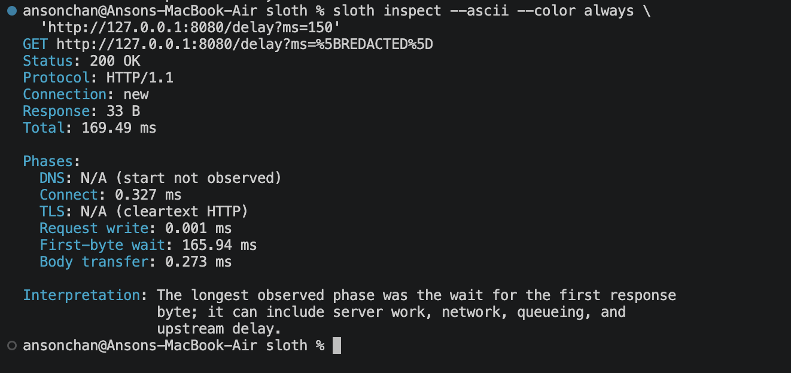

# Sloth

> Find out where an HTTP request spends time—without pretending client-side evidence is a server trace.

Sloth is a standalone Go CLI for bounded HTTP diagnosis. It measures seven client-observable latency intervals, runs controlled connection and concurrency experiments, applies six deterministic evidence rules, and saves privacy-safe reports that can gate regressions in CI.



## Install

Once `v1.0.0` is published, download the archive for macOS, Linux, or Windows from [GitHub Releases](https://github.com/ansonnchan/sloth/releases), verify it against `checksums.txt`, and place `sloth` (`sloth.exe` on Windows) on `PATH`. Complete archive and checksum instructions are in [Release artifacts and installation](docs/releases.md).

After the `v1.0.0` tag is published, Go users can install the same source revision with:

```sh
go install github.com/ansonnchan/sloth/cmd/sloth@v1.0.0
```

## Sixty-second local quick start

Start the deterministic loopback-only sample API:

```sh
go run ./examples/sample-api --listen 127.0.0.1:8080
```

In another terminal, inspect one delayed response:

```sh
sloth inspect http://127.0.0.1:8080/delay?ms=120
```

Then run a small diagnostic suite against a concurrency-sensitive route:

```sh
sloth diagnose --requests 10 --warmups 0 --rate 100 --concurrency 1,2 \
  http://127.0.0.1:8080/concurrency?delay_ms=30
```

The sample output is illustrative; real endpoint results depend on the client, network path, workload, and server.

## Four core workflows

```sh
# One bounded request with phase availability and one careful interpretation
sloth inspect https://api.example.com/health

# Baseline, connection reuse, and concurrency experiments with six rules
sloth diagnose https://api.example.com/health

# Atomic, versioned, redacted evidence
sloth export --output before.json https://api.example.com/health
sloth export --output after.json https://api.example.com/health

# Compatible deltas; optionally return exit 3 on a confirmed p95 regression
sloth compare --fail-on-regression 20 before.json after.json
```

See the complete [command and flag reference](docs/commands.md) for defaults, safety acknowledgements, machine JSON, and exit behavior.

## Real terminal recording

The committed [asciinema recording](docs/demo/sloth.cast) uses a real GoReleaser release-candidate binary and the local sample API. Play it with:

```sh
asciinema play docs/demo/sloth.cast
```

Its displayed metrics are genuine local measurements and illustrative only. Reproduction details and the exact RC commit are in the [demo notes](docs/demo/README.md).

## What Sloth measures

Sloth records total request time plus DNS, TCP connect, TLS, request write, first-byte wait, and body transfer when the Go HTTP trace exposes defensible boundaries. Missing, reused, cleartext, incomplete, or out-of-order phases remain `N/A`; phases are not forced to sum to total time.

The diagnostic suite keeps planned arrivals, scheduling delay, achieved rate, actual concurrency, outcomes, and warm-ups distinct. Findings separate observations, possible causes, and recommended next checks.

## What Sloth cannot prove

Sloth cannot see application code, database queries, internal queues, downstream traces, or a confirmed root cause. Client load, proxies, caches, HTTP/2 reuse, small samples, and coordinated omission can confound results. Read the [methodology and limitations](docs/methodology.md) before making production decisions.

## Safety, privacy, and automation

- Conservative defaults and hard ceilings bound requests, rate, concurrency, timeout, body reads, redirects, and report size.
- Unsafe methods and unusually large workloads require explicit noninteractive acknowledgements.
- Reports exclude raw URLs, query values, headers, cookies, credentials, request/response bodies, and raw underlying errors.
- Human output, machine JSON, progress streams, and exit codes have stable documented contracts.
- Comparison gates refuse incompatible, interrupted, zero-baseline, or insufficient evidence rather than silently passing.

## Architecture and documentation

Sloth is a local pipeline:

```text
validated config -> bounded experiments -> HTTP trace samples
                 -> exact aggregates -> deterministic findings
                 -> terminal/JSON report -> compatible comparison
```

Start with the [technical documentation index](docs/README.md), [architecture and ownership](docs/architecture.md), [timing semantics](docs/timing.md), and [diagnostic thresholds](docs/diagnostics.md).

## Development

Sloth requires Go 1.24 or newer. From the repository root:

```sh
test -z "$(gofmt -l .)"
go vet ./...
go test ./...
go test -race ./...
go build ./...
```

Contributions use `SH-XX-short-description` branches targeting `dev`. See [CONTRIBUTING.md](CONTRIBUTING.md) and [AGENTS.md](AGENTS.md).

## License

Sloth is released under the [MIT License](LICENSE).
