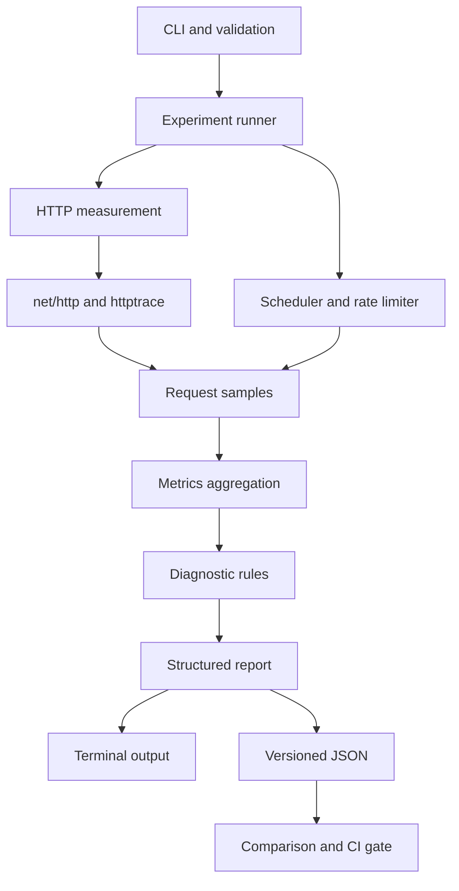

# Sloth

> Find out what's slowing you down.

Sloth is a lightweight HTTP diagnostic CLI that helps developers understand
where an API request spends time and which observable latency patterns deserve
further investigation.

Instead of acting as another general HTTP client or high-scale load generator,
Sloth combines bounded measurements, controlled experiments, statistics, and
evidence-based explanations in one local Go binary.

> [!NOTE]
> Sloth is under active development. Single-request inspection is available;
> diagnosis, export, and comparison remain planned v1 workflows until their
> roadmap milestones land.

## Workflows

```bash
# Inspect one bounded request (available)
sloth inspect http://localhost:8080/api/users

# Run controlled diagnostic experiments
# (planned)
sloth diagnose http://localhost:8080/api/users

# Save a versioned, redacted JSON report
sloth export http://localhost:8080/api/users

# Compare two compatible runs
sloth compare before.json after.json --fail-on-regression 20
```

Sloth will measure client-observable DNS, TCP, TLS, first-byte, and body-transfer
behavior where those phases are available. It will not claim to see internal
server execution, database queries, or downstream traces.

## Product principles

- Explain measurements without presenting hypotheses as confirmed root causes.
- Preserve unavailable timing phases as `N/A`, never invented zero values.
- Bound request count, rate, concurrency, timeout, response reads, and memory.
- Keep scheduling delay separate so overload is not silently hidden.
- Redact credentials and sensitive URL values from output and reports.
- Keep terminal output readable while providing stable machine-readable JSON.
- Require compatible workloads before declaring a regression or improvement.

## Architecture



The CLI, request execution, experiment scheduling, metrics, diagnosis, and
reporting layers remain separate so each can be tested independently.

## Roadmap

Work is organized as ordered `SH-XX` issues:

| Range | Milestone | Outcome |
|---|---|---|
| SH-01–SH-08 | Foundation | Buildable CLI, configuration, safety, and CI |
| SH-09–SH-18 | Inspect | Accurate bounded single-request measurement |
| SH-19–SH-30 | Runner & Metrics | Controlled scheduling, concurrency, and statistics |
| SH-31–SH-40 | Diagnosis | Six deterministic evidence-backed rules |
| SH-41–SH-51 | Export & Compare | Versioned reports, comparisons, and CI gates |
| SH-52–SH-58 | Hardening | Security, failures, benchmarks, examples, and docs |
| SH-59–SH-62 | v1 Release | Platform builds, packages, demo, and release review |
| SH-63–SH-68 | Post-v1 | Optional diagnostic and CI improvements |

See the [delivery roadmap](docs/planning/roadmap.md),
[context graph](docs/planning/context-graph.md), and
[issue backlog](docs/planning/issue-backlog.md) for the current planning source.
Shared runtime defaults are documented in [Configuration](docs/configuration.md).
Automation-facing streams and statuses are documented in the
[CLI contract](docs/cli-contract.md).
Version injection is documented in [Build metadata](docs/builds.md).

## Branch and release flow

```text
main  <---------------- milestone release PR ---------------- dev
                                                               ^
                                                               |
                                            SH-XX feature branches
```

- Feature branches are created from `dev` and use names such as
  `SH-16-add-inspect-command`.
- Feature pull requests target `dev` for integration and QA.
- `dev` is proposed for `main` only after a roadmap milestone's acceptance gate
  passes.
- Approval and merging are deliberate maintainer actions; agents stop before
  either unless explicitly authorized.

## Benchmark status

No performance or accuracy claims have been established yet.

The planned benchmark program will measure:

- HTTP trace and aggregation overhead;
- scheduler deviation and missed arrivals;
- allocation and memory bounds;
- cancellation behavior and goroutine stability;
- behavior across representative protocols and supported platforms.

Results will be published only with reproducible commands, environment metadata,
and the limitations needed to interpret them.

## Planned installation

Once the first release exists:

```bash
go install github.com/ansonnchan/sloth/cmd/sloth@latest
```

Standalone archives are planned for macOS ARM64/AMD64, Linux ARM64/AMD64, and
Windows AMD64. Homebrew publishing is intentionally post-v1.

## Development

The project uses Go and Cobra. Planned measurement work will use `net/http` and
`net/http/httptrace`; release automation will use GitHub Actions and GoReleaser.
See [CONTRIBUTING.md](CONTRIBUTING.md) for issue naming, branch workflow,
required checks, and pull-request expectations.

Run the current CLI from the repository root:

```bash
go run ./cmd/sloth --help
go run ./cmd/sloth --version
go run ./cmd/sloth inspect https://example.com --color never
```

Verification commands:

```bash
test -z "$(gofmt -l .)"
go vet ./...
go test ./...
go test -race ./...
go build ./...
```

Read [AGENTS.md](AGENTS.md) and the linked planning documents before changing
behavior. Implementation begins with `SH-01`.

## License

Sloth is released under the [MIT License](LICENSE).
