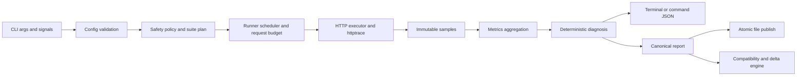
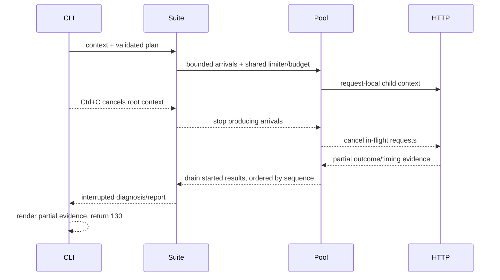

# Architecture and ownership

Sloth is a local, bounded measurement pipeline. No package owns a daemon, remote control plane, database, or telemetry uploader. The command invocation owns every resource and cancellation boundary.

Validation and safety evaluation finish before a body file is opened or a target is contacted. Network callbacks write only to a request-local trace collector. Completed samples cross into pure aggregation and diagnosis code; those layers do no network, filesystem, clock, or rendering work.

## Package boundaries

| Package | Owns | Does not own |
|---|---|---|
| `cmd/sloth` | process entry and build metadata injection | command behavior |
| `internal/cli` | Cobra syntax, streams, signals, presentation choice, exit mapping | HTTP timing formulas or rule thresholds |
| `internal/config` | defaults, validation, immutable snapshots | traffic execution |
| `internal/safety` | full-suite budget and normal/absolute ceilings | rate scheduling |
| `internal/httpmeasure` | request construction, transports, body bounds, `httptrace`, outcome taxonomy | experiment planning |
| `internal/inspect` | one-request orchestration and inspect document | multi-arm diagnosis |
| `internal/experiment` | immutable plans, samples, and execution records | goroutines or I/O |
| `internal/runner` | arrivals, no-burst limiter, worker pools, warm-ups, experiment transports | terminal rendering |
| `internal/metrics` | descriptive statistics and aggregates | causal interpretation |
| `internal/diagnosis` | versioned deterministic evidence rules | measurement or side effects |
| `internal/diagnose` | suite assembly and rule invocation | command presentation |
| `internal/report` | canonical model, schema validation, redaction boundary, atomic files | comparison policy |
| `internal/compare` | compatibility, deltas, and regression decision | generating reports |
| `internal/render` | width-aware human output | ANSI policy or command execution |

## Lifecycle and cancellation

The root command owns the signal-derived context. A suite owns one start limiter and request budget. Each stage owns its worker pool and transport; each request owns its trace collector, body reader, timeout, and sample. Producers close job channels, a waiter closes results after workers exit, and collectors drain already-started work. This avoids send-on-closed-channel races and preserves partial evidence without launching new work after cancellation.

Export adds a filesystem transaction after diagnosis: build in memory, validate against the bundled schema, write/sync/close a private temporary file in the destination directory, then atomically publish. Compare is read-only and never contacts the original target.

## Security and data boundaries

Target servers and configured proxies receive the request data the user explicitly supplied. Terminal output, errors, command JSON, samples, and reports instead receive redacted target identity and classified errors. Raw headers, cookies, credentials, request/response bodies, environment variables, usernames, hostnames, and interface data do not cross the reporting boundary. See the [threat model](security-threat-model.md) for residual risks.

## Verification map

- Ownership and cancellation: `internal/runner/*_test.go`, including race-detector CI.
- Timing boundaries: `internal/httpmeasure/trace_test.go` and `timing_test.go`.
- Safety-before-I/O: configuration/safety tests and CLI invalid-input tests.
- Privacy boundary: `internal/cli/privacy_test.go` and report schema fixtures.
- Atomic publication: report file tests and CLI export cancellation tests.
- End-to-end data flow: `internal/cli/sample_api_smoke_test.go`.

The corresponding roadmap work is SH-09–SH-18 (measurement), SH-19–SH-30 (runner/metrics), SH-31–SH-40 (diagnosis), SH-41–SH-51 (reports/comparison), and SH-52–SH-58 (hardening).
