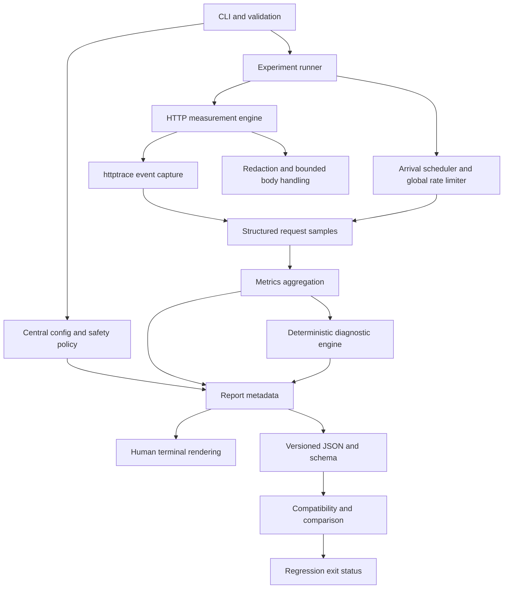

# Sloth context graph

## North star

Sloth turns client-observable HTTP evidence into careful, reproducible guidance:

```text
measurement -> controlled experiment -> statistical summary
            -> deterministic finding -> saved evidence -> comparison
```

The product wins when a developer can identify the next useful investigation
without Sloth pretending to see inside the server. Diagnostic credibility is
more important than the number of metrics or requests generated.

## Product invariants

1. Sloth reports observations separately from possible causes.
2. Unknown or inapplicable timing phases are unavailable, never zero-filled.
3. Every network operation is bounded by count, rate, concurrency, timeout,
   response-read, memory, and cancellation controls.
4. Warm-ups and measured requests are distinct, but both consume traffic budget
   and rate-limit capacity.
5. Planned arrival, actual start, client-observed service duration, and complete
   experiment duration are separate measurements.
6. A configured worker count is not evidence that the same concurrency was
   achieved or that load materially increased.
7. Reports do not contain secrets or bodies by default.
8. Machine output is stable, versioned, ANSI-free, and isolated from progress
   output.
9. Comparisons describe improvement or regression only when the relevant
   configurations are compatible.
10. The CLI is the product. A server may exist only as an example or test
    fixture, never as required Sloth infrastructure.

## User journeys and value

| Journey | User question | Sloth evidence | Outcome |
|---|---|---|---|
| Inspect | Where did one request spend time? | Trace events and body read | Phase-oriented report with one careful interpretation |
| Diagnose | Which observable pattern is most plausible? | Baseline, connection, concurrency, errors | Ranked, evidence-backed findings and next steps |
| Export | Can I preserve this run? | Config, environment, aggregates, findings | Atomic, versioned, redacted JSON report |
| Compare | Did behavior change? | Two validated reports | Deltas, compatibility warnings, optional CI gate |
| Learn | What do these measurements mean? | Methodology and limitations | Better networking and benchmarking intuition |

## System dependency graph



Dependencies point toward lower-level contracts. CLI commands orchestrate these
components but do not own measurement, statistics, diagnosis, or serialization
logic.

## Core domain model

### Request specification

- Redacted target identity plus runtime-only request URL
- Method, headers, optional body source, timeout, redirect policy
- Unsafe-method acknowledgement
- Response-body byte limit

Sensitive runtime values must not enter persisted models or error text.

### Request sample

- Planned start and actual start
- Scheduling delay
- Request start and completion elapsed times
- Trace observations with applicability and availability state
- HTTP protocol, status, transferred bytes, and reuse metadata
- Outcome category: success, HTTP error, timeout, transport error, cancelled, or
  body-limit failure/truncation
- Experiment and sequence identifiers

Durations should use a monotonic clock during collection. Serialization converts
them into fields with explicit units.

### Experiment result

- Stable experiment kind and ID
- Complete configuration snapshot
- Warm-up outcome summary kept separate from measured samples
- Aggregate latency, throughput, error, scheduling, concurrency, connection, and
  response-size metrics
- Optional bounded samples
- Start/end metadata and interruption state

### Finding

- Stable code, severity, qualitative confidence, and rule version
- Observation supported by typed evidence
- Possible causes clearly labeled as hypotheses
- Recommended next investigation
- Suppression or insufficiency reasons when applicable

### Report

- Schema/tool/rule versions
- Run ID and UTC timestamp
- Redacted target identity and compatibility fingerprint
- Effective configuration and bounded environment metadata
- Per-experiment results and separately defined overall summary
- Diagnostics and limitations
- Optional samples with an explicit maximum

## Measurement boundaries

The phase model must survive connection reuse, proxies, multiple address
attempts, HTTP/2, redirects, failures, and missing hooks.

| Metric | Proposed boundary | Important caveat |
|---|---|---|
| Scheduling delay | planned start -> actual worker start | Not part of HTTP service duration |
| Total request | immediately before `RoundTrip` -> body completion/terminal error | Includes client-visible transfer and protocol behavior |
| DNS | matching `DNSStart` -> `DNSDone` | May describe proxy resolution and may occur more than once |
| TCP connect | matching `ConnectStart` -> `ConnectDone` | Multiple address attempts may overlap or fail |
| TLS | `TLSHandshakeStart` -> `TLSHandshakeDone` | N/A for cleartext or reused TLS connections |
| Request write | first write hook -> `WroteRequest` | Hooks vary by protocol; unavailable is valid |
| First-byte wait | `WroteRequest` -> `GotFirstResponseByte` | Includes server work, network, queueing, and upstream delay |
| Body transfer | first response byte -> body completion | Closing early at the read cap can prevent reuse |

Phase durations must not be presented as an arithmetic decomposition unless the
captured intervals are known to be disjoint. The terminal UI should prefer a
waterfall/phase view and explain that connection setup can overlap or disappear
on reused connections.

## Diagnostic suite traffic model

The PRD defines measured requests per relevant experiment. A standard run can
therefore issue substantially more than `--requests` total requests. At the
initial defaults, a plausible suite is:

```text
baseline:                 100 measured + warm-up
fresh connection:         100 measured + warm-up
reused connection:        100 measured + warm-up
concurrency 1, 5, 10:     300 measured + warm-up per stage
                         ---------------------------------
minimum measured traffic: 600 requests
```

At 5 starts/second this is roughly two minutes before request durations and
other overhead. The CLI must display an estimated request count and duration
before starting, and a no-network dry-run is a valuable follow-up feature. The
same global limiter applies to warm-ups and all stages.

## Comparison compatibility graph

```text
schema readable?
  no  -> fatal validation error
  yes -> same target identity and method?
           no  -> incomparable; gate must fail validation
           yes -> same experiment kind and semantics?
                    no  -> omit unmatched metrics and warn
                    yes -> same timeout/rate/concurrency/body policy?
                             material mismatch -> descriptive only; no gate
                             compatible -> compute deltas and evaluate gate
```

Sample size differences are warnings unless below the minimum evidence required
for a selected conclusion. Zero baselines yield an absolute delta and an
undefined percentage, never infinity.

## Risk map

| Risk | Product consequence | Control |
|---|---|---|
| Trace events overlap or repeat | False phase totals | Preserve raw observations and derive conservatively |
| Client is rate-limited locally | Server blamed for local queueing | Separate scheduling delay and achieved load |
| Large bodies | Memory exhaustion or broken reuse | Stream to discard with a byte cap and record truncation |
| Unsafe repeated methods | Data mutation | Explicit acknowledgement and visible traffic estimate |
| Secrets in URLs/headers/errors | Credential disclosure | Redact before display, persistence, and wrapping errors |
| Small samples | Overconfident tails | Evidence thresholds and percentile caveats |
| Temporal drift between experiments | Biased connection comparison | Alternate/randomize deterministically and record order |
| HTTP/2 multiplexing | Misstated connection cost/concurrency | Report protocol and observed connection facts |
| Different report settings | Misleading before/after result | Compatibility matrix and gate refusal |
| Ctrl+C or partial failure | Leaks or invalid reports | Context cancellation, bounded lifecycle, interrupted state |
| Output stream mixing | Broken CI JSON | Data on stdout; progress/diagnostics on stderr |

## Traceability from goals to delivery areas

| Goal | Primary delivery areas |
|---|---|
| Explain one request | Request model, trace capture, timing derivation, inspect UI |
| Diagnose patterns | Runner, metrics, rule engine, evidence model |
| Reproduce measurements | Config snapshots, methodology, environment metadata |
| Compare changes | Schema, compatibility, deltas, regression gate |
| Integrate with CI | Stable output, exit codes, deterministic validation |
| Stay lightweight | Standalone Go binary, standard library bias, no services |
| Be safe | Traffic ceilings, unsafe-method policy, privacy, bounded resources |
| Be credible | Synthetic rule tests, integration tests, race detector, benchmarks |

## Product improvements beyond the original PRD

These ideas are intentionally separated from the v1 critical path:

1. `diagnose --dry-run` to show planned experiments, total request budget, and
   estimated minimum duration without network traffic.
2. `sloth analyze <report.json>` to rerun newer deterministic diagnostic rules
   against compatible saved evidence without contacting the endpoint.
3. Target fingerprints computed from a redacted canonical identity so reports
   can compare safely without retaining query secrets.
4. Repeated-run comparison that summarizes between-run variance rather than
   implying one noisy pair is statistically definitive.
5. Phase-level comparison for connection, first-byte, body-transfer, and
   scheduling regressions, not only total latency.
6. An explicit machine-readable CI summary format after JSON contracts stabilize
   (for example JUnit), without coupling the core to a CI vendor.

These must receive their own issue IDs and acceptance criteria before work.
